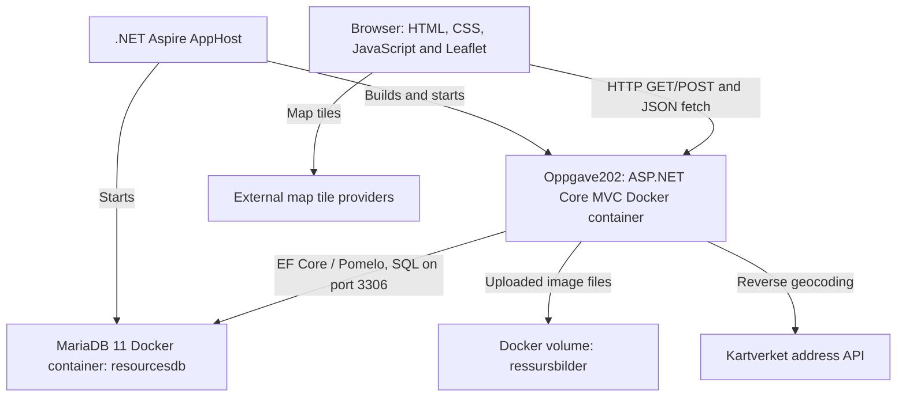
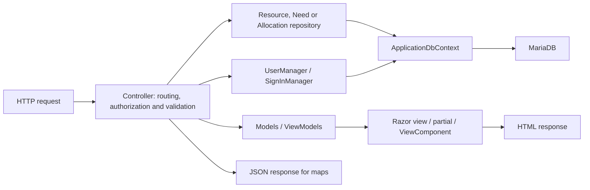

# System Architecture – CrisisSystem / Ko/ordinert

## Scope and overview

This document describes the implementation in this checkout, reviewed on 19 November 2026. The application is branded **Ko/ordinert** in the interface; the project and solution still use the CrisisSystem/IS202Oppgave1 names.

The system is a single **ASP.NET Core MVC application targeting .NET 10**, with server-rendered Razor views and JavaScript for maps and interface interactions. It uses **Entity Framework Core 9**, the **Pomelo MySQL provider**, **ASP.NET Core Identity** and **MariaDB 11**. It is not a set of separate business microservices: the controllers, repositories, authentication and views run in the same web application.

## Runtime architecture

[AppHost.cs](IS202Oppgave11.AppHost/AppHost.cs) defines the MariaDB container and builds the web container from [202Oppgave/Dockerfile](202Oppgave/Dockerfile). The web endpoint is exposed at `http://localhost:5027` with container target port `8080`. The Dockerfile uses separate build, publish and runtime stages and runs the application as a non-root user.

The web application reads `ConnectionStrings:DefaultConnection` from its configuration. The checked-in configuration targets database `resourcesdb` at `mariadb:3306`. AppHost currently does not inject this connection string through an Aspire database reference and does not declare a database-readiness dependency. The application needs a reachable database during startup.

## Application layers

| Part | Current responsibility |
|---|---|
| `Controllers/` | Receive requests, validate forms, check access, coordinate persistence and return views, redirects, files or JSON. |
| `Models/Entities/` | Database entities: `Resource`, `Need`, `Category` and `Allocation`. |
| `ApplicationUser` | Identity user extended with application-specific profile data. |
| `Models/` and `ViewModels/` | Presentation data and form data, including validation attributes. These are distinct from the database entities. |
| `DataAccess/Repositories/` | EF Core queries and updates for resources, needs and allocations. Interfaces are registered as scoped dependencies in `Program.cs`. |
| `ApplicationDbContext` | Shared EF Core context for domain tables and Identity tables, including relationships and delete behavior. |
| `Services/` | Nearby resource suggestions, Excel export, Identity seeding and development email logging. |
| `Views/` and `ViewComponents/` | Server-rendered pages and reusable UI. `AllocatedResourcesViewComponent` loads allocations for a need. Some views also inject the allocation repository directly. |
| `wwwroot/` | Styles, scripts, images and uploaded resource photos. Leaflet and Leaflet.draw provide map display and drawing. |

The interface uses custom CSS, responsive layouts, Razor Tag Helpers and client-side validation. It is not a separate frontend application or a general-purpose REST API.

### Controllers

| Controller | Responsibility |
|---|---|
| `HomeController` | Landing page, database-derived need summary, privacy and error pages. |
| `ResourceController` | Resource registration, details, editing, deletion, filtering, Excel export, image uploads and geographic JSON. |
| `NeedController` | Need registration, list, details/confirmation, editing, deletion and geographic JSON. |
| `AllocationController` | Direct allocation, nearby suggestions, provider offers, approval and removal. |
| `AccountController` | Registration, cookie login/logout, access-denied page and password reset. |
| `ResourceProviderController` | The provider's overview, own resources and profile settings. |
| `PublicActorController` | The public actor's overview, own needs and profile settings. In this checkout the controller is restricted to the PublicActor role. |
| `KartController` | Map overview and reverse geocoding. |
| `InformationController` | About, help and contact pages. The contact form returns a confirmation view; it does not store or email submissions. |

## Database and file storage

[ApplicationDbContext.cs](202Oppgave/DataAccess/ApplicationDbContext.cs) inherits from `IdentityDbContext<ApplicationUser, IdentityRole, string>`. Identity accounts and the application's domain data therefore use the same database.

| Relationship | Implementation |
|---|---|
| User → resources | `Resource.UserId` identifies the creator. Nullable for older records; deleting a referenced user is restricted. |
| User → needs | `Need.UserId` identifies the creator. Nullable for older records; deleting a referenced user is restricted. |
| Category → resources | Optional `Resource.CategoryId`. Deleting a category sets the reference to null. Eleven categories are seeded through EF Core. |
| Need → allocations | One-to-many: each need can have multiple allocations. Each allocation references exactly one need through `NeedId`. |
| Resource → allocations | One-to-many: each resource can have multiple allocations. Each allocation references exactly one resource through `ResourceId` and stores state, date and an optional note. There is no direct foreign key between Need and Resource. |
| Resource/need → allocations | Deleting a resource or need cascades to its allocation rows. Need deletion also releases resources that are not attached to another need. |

Resources and needs store latitude, longitude and optional `GeometryJson` for drawn geometry. Resource images are stored as files, with only `ImagePath` stored in the database.

Schema changes are versioned in `202Oppgave/Migrations/`. The model snapshot is EF Core's reference for generating later migrations; it does not create tables by itself. At startup, `Program.cs` calls `Database.Migrate()` to apply migrations, then seeds roles and example users. Startup fails if migration/database access fails. `ApplicationDbContextFactory` supplies the context to EF tooling at design time.

### Storage lifetime

- **Database records:** resources, needs, categories, allocations and Identity data are stored in MariaDB, not in application-memory lists.
- **Database container:** AppHost uses `ContainerLifetime.Persistent`, but does not explicitly configure a named database volume or bind mount. Keeping a container alive is not the same as defining durable storage for container replacement; this configuration does not guarantee preservation when MariaDB is removed/recreated.
- **Uploaded images:** AppHost explicitly mounts the named volume `ressursbilder` at `/app/wwwroot/uploads`. Resource photos are saved under `uploads/ressurser`.
- **Map data:** All resource and need locations are stored in MariaDB through the existing repositories. The map retrieves persisted data through `/Resource/Geo` and `/Need/Geo`. No separate map-point table is required.
## Identity and access control

ASP.NET Core Identity stores users, password hashes, roles and related Identity data in MariaDB. Authentication uses cookies through `SignInManager`; this is not JWT authentication.

- Self-registration allows `ResourceProvider` and `PublicActor`. It does not allow users to select `Admin`.
- Resource creation is restricted to providers and admins; need creation to public actors and admins.
- Controllers perform role and/or ownership checks for protected operations. Rules differ by action: for example, `NeedController` editing/deletion requires the actual creator, while allocation approval/removal allows the need's creator in the PublicActor role or an admin.
- Providers can offer only resources they own. Ownership is checked again on submission, rather than trusting hidden resource IDs.
- Form validation uses model validation. State-changing resource, need and allocation forms use POST and antiforgery validation.
- Login enables lockout after five failed attempts for five minutes. Email confirmation is not required in the current configuration.
- Password-reset emails use `ConsoleEmailSender`, which writes the message to application logs. No external email delivery service is configured.

## Main request flows

### Registration and editing

1. A GET request renders a form with a ViewModel.
2. The browser submits fields and map coordinates/geometry in a POST.
3. The controller validates the model and checks the user's access. Invalid data returns the form with errors.
4. Valid input is mapped to an entity and saved through a repository and `ApplicationDbContext`.
5. The controller redirects to the details/confirmation page, which reloads the saved data.

Image files are handled by `ResourceController`; their paths are saved with the resource.

### Allocation and provider offers

**Direct allocation:** PublicActor/Admin selects available resources and a need. `AllocateAsync` creates `Bekreftet` allocations and sets the resources to `Utilgjengelig`. The need-based suggestion page searches available resources within 5 km using Haversine distance, applies search/category filters and shows at most the three nearest matches.

**Provider offer:**

1. “Tilby ressurs” opens `/Allocation/Create` with the selected resource.
2. “Send til godkjenning” creates a `Forespurt` allocation and sets the resource to `Reservert`.
3. The offer appears under the need as awaiting approval.
4. The need's authorized owner or admin can approve it: state becomes `Bekreftet`, resource status becomes `Utilgjengelig`.
5. Removing the offer/allocation releases the resource if no other allocation references it.

Offer reservation and approval use database transactions and conditional updates to avoid processing the same offer/reservation twice. The existing allocation state is reused; there is no separate offer table.

### Map display

The main overview at `/Kart/Oversikt` fetches JSON from `/Resource/Geo` and `/Need/Geo`. Those endpoints read repository data and expose coordinates/geometry for Leaflet. Resource geographic data is role-protected; provider-only users receive their own resources.

Map backgrounds are loaded directly by the browser: OpenStreetMap standard tiles, OpenTopoMap topographic tiles and Esri World Imagery satellite tiles. `wwwroot/js/map-layers.js` supplies the shared layer selector. Changing the background does not change the stored markers or drawings.

Address suggestions for selected coordinates go through `/Kart/ReverseGeocode`, which calls Kartverket's address API from the web application. Failed lookups return an error response so the user can enter the location manually.

These are HTTP request/response flows. There is no SignalR hub, message queue or background notification worker in this checkout.

## Startup and observability

`Program.cs` registers MVC, repositories, EF Core and Identity, applies migrations and seeds Identity data. It then configures static files, routing, authentication, authorization and the default `{controller=Home}/{action=Index}/{id?}` route.

`IS202Oppgave11.ServiceDefaults` configures service discovery, HTTP client resilience, health checks and OpenTelemetry. OTLP export is conditional on `OTEL_EXPORTER_OTLP_ENDPOINT` being configured. The default `/health` and `/alive` endpoints are mapped only in Development. The Aspire dashboard shows orchestration state, endpoints and container output; telemetry export should not be assumed merely because AppHost is running.

## Architecture source files

- [Application startup](202Oppgave/Program.cs)
- [Aspire orchestration](IS202Oppgave11.AppHost/AppHost.cs)
- [Container build](202Oppgave/Dockerfile)
- [Database mapping](202Oppgave/DataAccess/ApplicationDbContext.cs)
- [Repositories](202Oppgave/DataAccess/Repositories)
- [Schema migrations](202Oppgave/Migrations)
- [Shared service configuration](IS202Oppgave11.ServiceDefaults/Extensions.cs)
- [Automated test project](CrisisSystem.Tests/CrisisSystem.Tests.csproj)

[Back to README](README.md)
